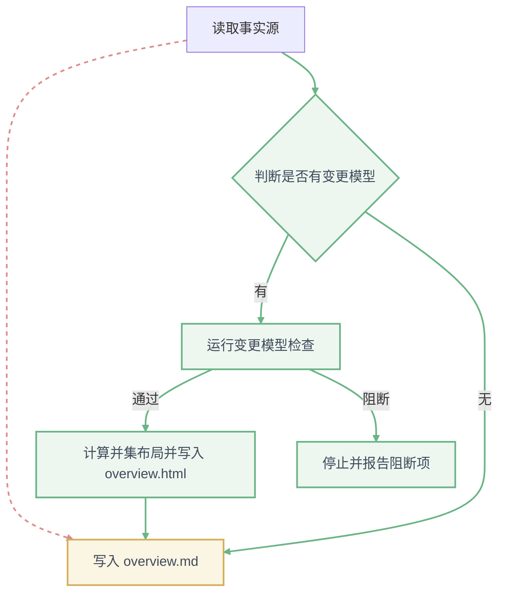

# 变更总览：add-change-model-visualization

> 本文件由 `/opsx:overview` 生成，**请勿手动编辑**。
> 事实源：proposal.md / design.md / specs/*/spec.md / tasks.md / review-summary.md。
> 内容有误请改事实源后重新运行 `/opsx:overview add-change-model-visualization`。
> 最近生成：2026-10-08 ｜ 依据轮次：无（本变更未启用技术评审门禁，没有 review-summary.md）

**规则条件统计：共 38 条条件，未落地 0 条。** 全部任务已完成。

## 1. 文档地图

| 文档 | 回答什么问题 | 路径 | 状态 | 是否最新 |
|------|------------|------|------|---------|
| proposal | 为什么做、改什么、影响范围 | `proposal.md` | 已定稿 | 最新 |
| design | 怎么做：格式、检查算法、并集布局、渲染、卡点接入 | `design.md` | 已定稿 | 最新（基准） |
| spec：change-model | 变更模型格式、6 项检查、卡点调用的行为契约 | `specs/change-model/spec.md` | 已定稿 | 可能滞后（早于 design.md） |
| spec：change-model-rendering | 并集布局、布局 JSON、Mermaid、overview.html 的行为契约 | `specs/change-model-rendering/spec.md` | 已定稿 | 可能滞后（早于 design.md） |
| tasks | 做哪些活、进度 | `tasks.md` | 已完成（21/21） | 最新 |
| review-summary | 技术评审门禁结论 | `review-summary.md` | 缺失（未启用门禁） | — |
| 交互式总览图 | 流程变动的前后对比 | `overview.html` | 已生成 | 最新 |

## 2. 端到端运行流程

<!-- change-model:begin -->
#### 流程：生成变更总览（generate-overview）

图例：➕ 新增　✏️ 修改　❌ 删除；绿色为新增，黄色为修改，红色虚线为删除。
<!-- change-model:end -->

交互式对比视图：[overview.html](overview.html)

图中没有的标注：

- **输入与输出**：F1 输入为 proposal / design / specs / tasks / review-summary；F3 输入 `<changeRoot>`，输出检查报告 JSON `{ verdict, blocking, warnings, exemptions }`；F4 输出 `overview.html`；F5 输出 `overview.md`。
- **同步 / 异步边界**：全部同步执行；`check` 内部同步调用 `ste-lint.mjs text` 子进程（CM-2）。
- **失败分支**：F3 阻断（退出码 1）→ F6 停止并列出阻断项，不写 overview.md 与 overview.html；F3 参数或环境错误（退出码 2，如变更目录不存在、CONTEXT.md 非法）→ 报告错误并停止；找不到 `openspec-ste` → 跳过 CM-2 并告警，其余规则照常执行。
- **重试与幂等点**：`check`、`layout`、`render`、`mermaid` 都是幂等的，同一模型与同一 skill 版本重复执行输出字节一致，可以安全重跑。

## 3. 字段变更台账

**存储侧**：本变更不涉及数据库表。

| 表 | 字段 | 类型 | 新增/修改/废弃 | 写入方 | 读取方 | 默认值与迁移方式 | 来源(design 章节) |
|----|------|------|--------------|--------|--------|----------------|------------------|
| — | — | — | — | — | — | 无存储侧变更；历史变更不追溯（没有 design.md 不要求可视化判定，没有模型保持 ASCII） | Migration Plan 第 3 条 |

**链路侧**（design.md `change-model` 代码块 → 布局 JSON / overview.html / Mermaid）：

| 外部入参 | DTO 字段 | 领域对象字段 | 表字段 | 出参字段 | 变形说明 |
|---------|---------|------------|--------|---------|---------|
| `diff`（可不写） | — | `diff` | — | 布局 JSON `diff` | 不写时归一化为 `unchanged`；Mermaid 映射为 `class` 与 ➕ / ✏️ / ❌ 前缀 |
| `before`（可不写） | — | `before` | — | 布局 JSON `before` | 不写时为 `null`；`before.from` / `before.to` 与当前不同时派生旧路线连线 `<id>@before`（`route: before`、`of: <id>`） |
| edge `from` + `to` | — | 连线标识 | — | 布局 JSON 连线 `id` | 连线没有 `id`，改名为 `<from>-><to>` |
| transition `trigger` + `guard` | — | 迁移标签 | — | 布局 JSON `text`、SVG 标签、Mermaid 标签 | 合并为 `trigger [guard]` |
| `name` / `trigger` / `guard` / `label` | — | STE 输入行 | — | 检查项 `CM-2` | 每个值一行传给 `ste-lint.mjs text`；`before` 中的旧值被丢弃（不检查） |
| 状态 / 步骤 `id` | — | 元素 ID | — | Mermaid 节点 ID | 非字母数字字符改为 `_`，保留字与重复加前缀或后缀 |
| — | — | ELK 布局结果 | — | 布局 JSON `x` / `y` / `width` / `height` / `points` / `labelBox` | 新增派生字段，坐标保留 1 位小数 |
| `scenarios`、`causes`、`actor`、`kind`、`async`、`initial`、`final` | — | 同名字段 | — | 布局 JSON 同名字段 | 原样传递；未写时 `scenarios` / `causes` 为 `[]`，`actor` / `kind` 为 `null`，布尔值为 `false` |

## 4. 规则条件可追溯矩阵

| 条件ID | 来源 | 条件内容 | 落在 tasks 哪一项 | 实现位置 | 状态 |
|--------|------|---------|-----------------|---------|------|
| PROP-1 | proposal | 新增变更模型格式（machines / flows、causes、diff / before、scenarios），不含时序图、字段变更、代码映射 | 1.1、1.2 | `shared/change-model.md`、`change-model.mjs` checkSchema | 已完成 |
| PROP-2 | proposal | 6 项检查全部阻断 | 1.2、1.3 | `change-model.mjs` check | 已完成 |
| PROP-3 | proposal | design.md 存在时必须有「可视化判定」小节 | 1.2、4.2 | checkDecision；propose 编写说明 | 已完成 |
| PROP-4 | proposal | 内置 elkjs 计算一次布局，输出布局 JSON、派生 Mermaid、离线 overview.html | 2.1～2.4、3.1 | layout / render / mermaid | 已完成 |
| PROP-5 | proposal | overview skill 有变更模型时生成 overview.html，第 2 块嵌入 Mermaid | 3.2、3.4 | `openspec-change-overview/SKILL.md` | 已完成 |
| PROP-6 | proposal | 四个 OpenSpec skill 在 STE 检查的同一卡点运行变更模型检查 | 4.1 | 四个 skill 与命令 | 已完成 |
| SPEC-1 | change-model | Unchanged element | 1.2、1.4 | checkSchema；layout 归一化 | 已完成 |
| SPEC-2 | change-model | Unsupported section | 1.2、1.4 | checkSchema | 已完成 |
| SPEC-3 | change-model | Step causes a transition | 1.2、1.4 | checkSchema | 已完成 |
| SPEC-4 | change-model | Added transition without a scenario | 1.2、1.4 | checkCoverage | 已完成 |
| SPEC-5 | change-model | Scenario reference does not exist | 1.2、1.4 | checkCoverage | 已完成 |
| SPEC-6 | change-model | Changed element without before | 1.2、1.4 | checkCoverage | 已完成 |
| SPEC-7 | change-model | Removed state still targeted | 1.2、1.4 | checkCoverage | 已完成 |
| SPEC-8 | change-model | Valid reference | 1.2、1.4 | scenarioIndex | 已完成 |
| SPEC-9 | change-model | Missing section | 1.2、1.4 | checkDecision | 已完成 |
| SPEC-10 | change-model | Declared hit without a model | 1.2、1.4 | checkDecision | 已完成 |
| SPEC-11 | change-model | No design.md | 1.2、1.4 | checkChange | 已完成 |
| SPEC-12 | change-model | Forbidden alias in a trigger | 1.3、1.4 | checkAliases | 已完成 |
| SPEC-13 | change-model | STE skill missing | 1.3、1.4 | checkAliases | 已完成 |
| SPEC-14 | change-model | Apply with a blocking change-model finding | 4.1 | apply skill 与命令 | 已完成 |
| SPEC-15 | change-model-rendering | Unchanged state keeps its position | 2.2、2.5、2.6 | 并集布局；模板视图样式 | 已完成 |
| SPEC-16 | change-model-rendering | Render twice | 2.2、2.5 | ELK_OPTIONS、按 ID 排序 | 已完成 |
| SPEC-17 | change-model-rendering | Blocking finding exists | 2.4、2.5 | run：先 check | 已完成 |
| SPEC-18 | change-model-rendering | Layout JSON contains diff data | 2.2 | layoutGraph | 已完成 |
| SPEC-19 | change-model-rendering | No external resources | 2.3、2.5 | 模板、renderHtml | 已完成 |
| SPEC-20 | change-model-rendering | Select a changed transition | 2.3、2.6 | 模板侧栏 | 已完成 |
| SPEC-21 | change-model-rendering | Select a step that causes a transition | 2.3、2.6 | 模板联动高亮 | 已完成 |
| SPEC-22 | change-model-rendering | Overview with a change model | 3.2、3.4 | SKILL.md 第 2 块；本文件 | 已完成 |
| SPEC-23 | change-model-rendering | Overview without a change model | 3.2、2.5 | SKILL.md 第 2 块；render 无模型不写文件 | 已完成 |
| DESIGN-1 | design Goals | 图由脚本确定性生成，变更模型为唯一事实源 | 2.2、2.4、3.1 | layout / render / mermaid | 已完成 |
| DESIGN-2 | design Goals | 新增或修改的迁移与步骤必须挂 Scenario | 1.2 | checkCoverage | 已完成 |
| DESIGN-3 | design Goals | overview.html 离线单文件，提交 git | 2.4、3.4 | renderHtml | 已完成 |
| DESIGN-4 | design §1 | js-yaml 另存一份，未安装 openspec-ste 时仍可解析 | 1.2 | `vendor/js-yaml.mjs` | 已完成 |
| DESIGN-5 | design §1 | elkjs 原样内置、保留 LICENSE、createRequire 加载 | 2.1 | `vendor/elk.bundled.js`、`vendor/elk.LICENSE.md` | 已完成 |
| DESIGN-6 | design §3 | 输出 JSON 与退出码与 `ste-lint.mjs check` 一致 | 1.2 | run / reportOutput | 已完成 |
| DESIGN-7 | design Risks | 节点宽度按字数计算并设上限，超出换行 | 2.2 | nodeSize、wrapText | 已完成 |
| DESIGN-8 | design Risks | overview.html 只由 render 生成，禁止手改 | 3.2 | SKILL.md 铁律 | 已完成 |
| DESIGN-9 | design Migration | 打包包含 `assets/` 与 `vendor/` | 4.3 | `scripts/pack-skill.sh` | 已完成 |

共 38 条条件，未落地 0 条。

**无来源的任务**：5.1～5.3 来自 `/opsx:quality` 第 1 轮的有条件通过条件（`review/code-review-summary.md` 的 SPEC-01、SPEC-02、STD-01），不在上表四类来源内，已全部完成。其余无。4.3 中「`npm run verify` 无断链」与 4.4「对本变更运行 check」是交付验证，追溯到 PROP-6 与 DESIGN-9。

## 5. 未决问题与假设

**未决问题**

| 问题 | 来源 | 候选选项 |
|------|------|---------|
| ~~`overview.html` 视觉样式~~ 已确认：白底、低对比度配色、字重 500 | design Open Questions、任务 2.6 | — |
| ~~视图切换的交互形式~~ 已确认：标签页 | design Open Questions | — |
| ~~多个 machine 与 flow 时的页面导航~~ 已确认：纵向排列 + 顶部跳转链接 | design Open Questions | — |
| decision 节点过多导致图过宽 | design Risks | 第一版接受，暂不处理 |

**隐含假设**

- 变更模型中的状态机与流程按 design.md 中的顺序显示，图内元素按 ID 排序后布局。
- `edge` 允许 `before`（只含 `label`）：spec 允许连线 `diff: changed`，规则 4 要求 `changed` 必须有 `before`；design 字段表已同步。
- `/opsx:overview` 遇到变更模型阻断项时整体停止（与流程中 F3 → F6 一致），不只跳过第 2 块。
